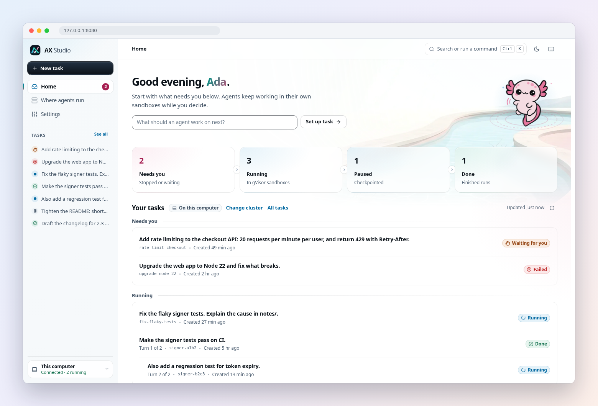
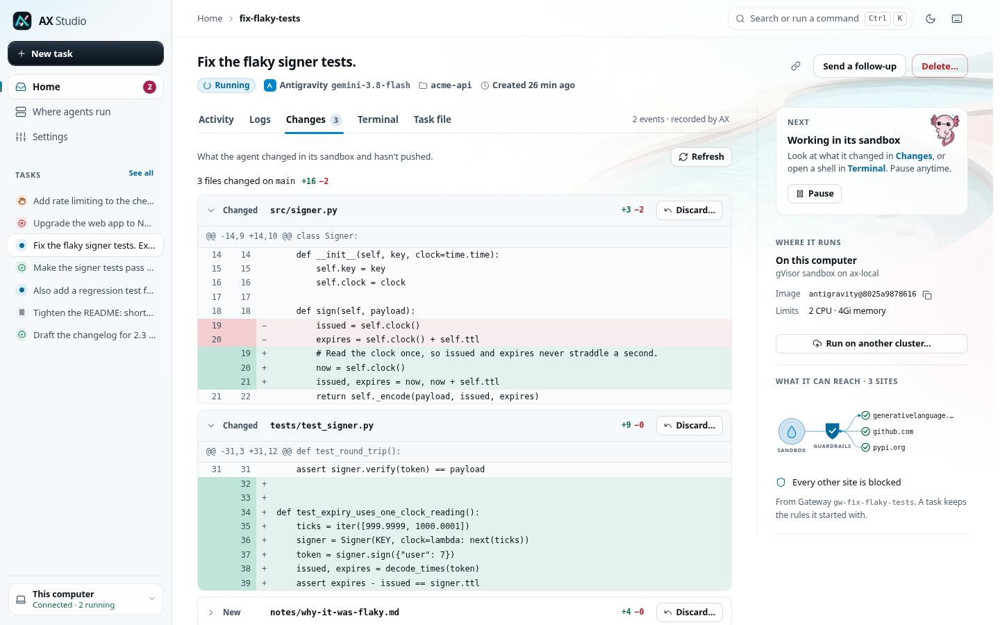
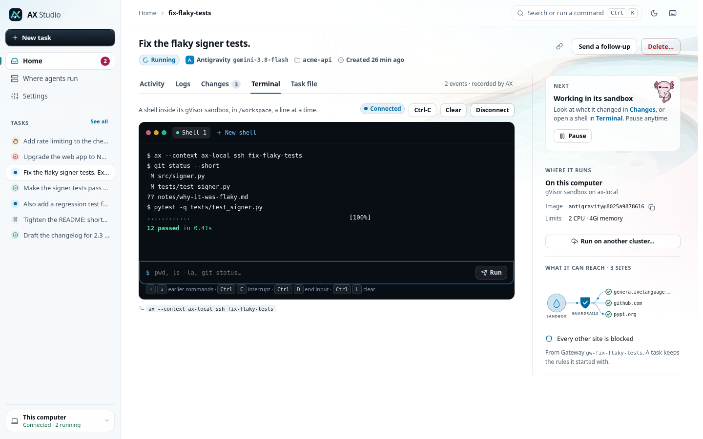
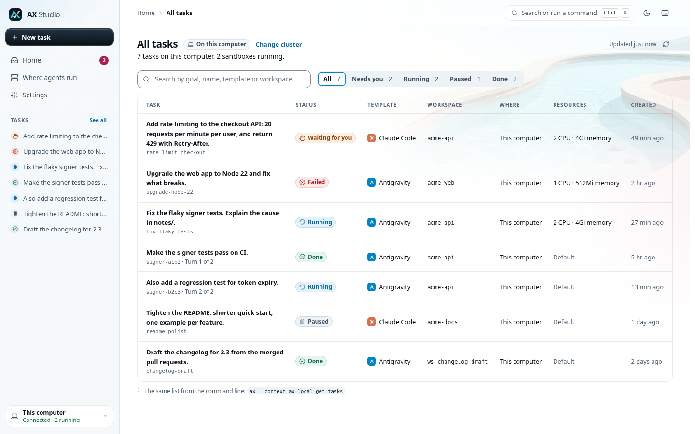
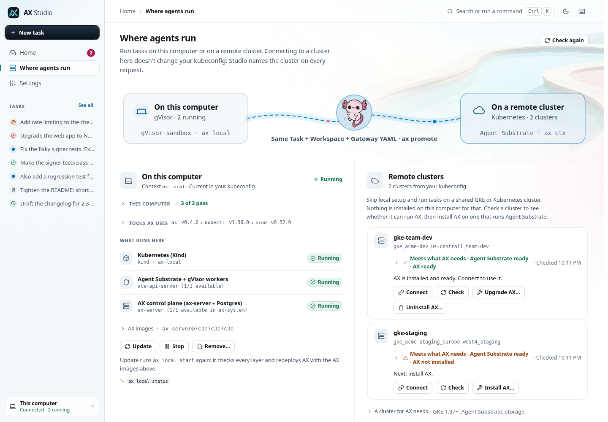
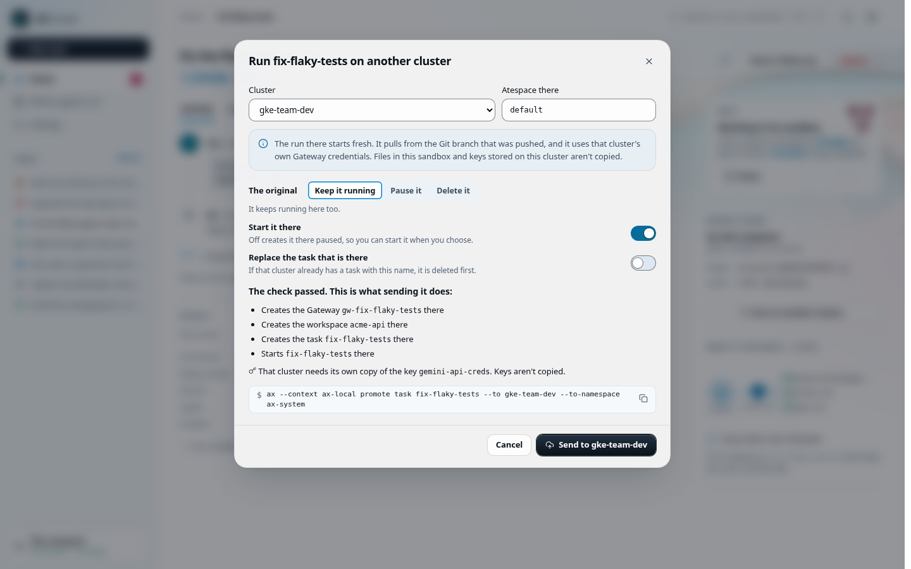
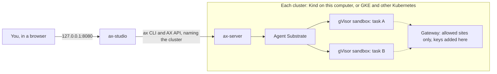

<div align="center">

# AX Studio

**Run coding agents in secure sandboxes, on your computer or your team's cluster,<br>and review every change before it reaches your code.**

[](https://github.com/agentexecutor/studio/actions/workflows/ci.yml) [](LICENSE)

[Quick start](#quick-start) · [Tour](#a-quick-tour) · [How it works](#how-it-works) · [For agents](#for-agents-and-scripts) · [Reference](#reference) · [Troubleshooting](#troubleshooting) · [Development](#development)

<a href="#quick-start">
  
</a>

</div>

## What is AX Studio?

AX Studio is the local web app for [AX](https://github.com/google/ax). It's one small binary that opens in your browser and works with AX wherever it runs: on a Kubernetes cluster that AX sets up on your computer, or on any cluster in your kubeconfig that runs Agent Substrate.

- **Start a task in a minute.** Pick a template (the agent and its model), where it runs, the code it starts with, and describe the goal.
- **Watch it work, safely.** Each agent runs in its own gVisor sandbox and can only reach the sites you allow. Its API key is added outside the sandbox, so the agent never holds it.
- **Review before anything lands.** See the diff, open a shell in the sandbox, push a branch, or apply the changes to a folder on your computer.
- **Move work where it belongs.** Start on your laptop, then run the same task on a team cluster with `ax promote`.

## Quick start

You need `ax`, AX's command-line tool, at the version Studio is built against or later. Studio uses it to set up AX, start tasks and open shells.

**1. Get the code and a matching `ax`** (needs Go 1.27 or later):

```bash
git clone https://github.com/agentexecutor/studio && cd studio
ax_version="$(go list -m -f '{{.Version}}' github.com/google/ax)"   # the ax version in go.mod
GOBIN="$HOME/.ax/bin" go install "github.com/google/ax/cmd/ax@$ax_version"
```

This installs the `ax` version pinned in [`go.mod`](go.mod). The latest AX release, v0.3.1, is older than Studio needs: it doesn't have `ax local status -o json`.

**2. Build and start Studio:**

```bash
make build        # also needs Node.js 20 or later
./bin/ax-studio   # opens http://127.0.0.1:8080
```

No Node.js? `go build -o bin/ax-studio ./cmd/ax-studio` builds the same app without the previous pages at `/classic/`.

**3. Choose where agents run.** On **Where agents run**, either:
- **Set up AX on this computer.** Studio runs `ax local start`, which creates a Kind cluster with Agent Substrate and AX in Docker or Podman. It asks for an AX server image, unless `AX_SERVER_IMAGE` is set.
- **Use a remote cluster** from your kubeconfig. Check it, then install AX on it (`ax install`).

**4. Start a task.** Click **New task**, describe the goal, and press **Run task**.

> [!TIP]
> When an AX release includes AX Studio, AX's installer sets up both tools, and `ax studio` starts Studio:
> ```bash
> curl -fsSL https://github.com/google/ax/releases/latest/download/install.sh | sh
> ax studio
> ```

Stopping Studio (`Ctrl-C`) only stops the web app. Your clusters and their tasks keep running.

## A quick tour

<p align="center">
  <picture>
    <source media="(prefers-color-scheme: dark)" srcset="docs/screenshots/home-dark.png">
    
  </picture>
</p>

<p align="center"><b>Home.</b> Your tasks, sorted by what needs you: waiting for you, running, paused and done.</p>

<table>
  <tr>
    <td width="50%" valign="top"><br><b>New task.</b> Pick a template, where it runs, the code it starts with, and the goal. The plan on the right says what's left.</td>
    <td width="50%" valign="top"><br><b>A task.</b> What AX recorded, what to do next, where it runs, and the sites it can reach.</td>
  </tr>
  <tr>
    <td width="50%" valign="top"><br><b>Changes.</b> Review what the agent changed and hasn't pushed. Discard a file, push a branch, or apply it to a folder on your computer.</td>
    <td width="50%" valign="top"><br><b>Terminal.</b> A shell in the task's sandbox, through <code>ax ssh</code>. Open more shells as tabs.</td>
  </tr>
  <tr>
    <td width="50%" valign="top"><br><b>Logs.</b> What the agent and its sandbox print, as it happens.</td>
    <td width="50%" valign="top"><br><b>All tasks.</b> Search and filter every task on the cluster.</td>
  </tr>
  <tr>
    <td width="50%" valign="top"><br><b>Where agents run.</b> Set up AX on this computer, or check a cluster and install AX there.</td>
    <td width="50%" valign="top"><br><b>Run on another cluster.</b> Studio checks the target first (<code>ax promote --preflight-only</code>), then sends the task.</td>
  </tr>
</table>

## How it works



- **Local only.** Studio listens on `127.0.0.1` and nowhere else. Nothing is exposed to your network.
- **Your kubeconfig stays yours.** Studio names the cluster on every request (`--context`). It never switches or edits your contexts.
- **Sandboxed agents.** Each task runs in its own gVisor sandbox on Agent Substrate. Its outbound traffic goes through a Gateway that allows only the sites the task needs.
- **Keys stay outside.** An API key you give Studio is stored on the cluster as a Secret. The Gateway adds it to the agent's requests, so it never enters the sandbox.
- **No lock-in.** Every action shows the `ax` command that does the same, ready to copy.

## For agents and scripts

Everything Studio does has an `ax` equivalent, so an agent should drive AX directly. Add `-a <atespace>` when you don't use the `default` atespace.

| In Studio | The same with `ax` |
|:---|:---|
| Your tasks | `ax --context <cluster> get tasks` |
| A task's details | `ax --context <cluster> get task <name>` |
| New task | `ax --context <cluster> apply -f task.yaml`, then `ax --context <cluster> resume task <name>` |
| Pause, resume, delete | `ax --context <cluster> suspend task <name>` (or `resume`, `delete`) |
| Terminal | `ax --context <cluster> ssh <name>` |
| Run on another cluster | `ax --context <from> promote task <name> --to <cluster>` (check first with `--preflight-only`) |
| AX on this computer | `ax local start`, `ax local stop`, `ax local delete`, `ax local status -o json` |
| AX on a remote cluster | `ax --context <cluster> install`, `ax --context <cluster> uninstall` |
| Workspaces, Gateways, models | `ax --context <cluster> get workspaces` (or `gateways`, `models`) |

<details>
<summary><strong>Reading what Studio sees</strong> (its local API)</summary>

Studio's API serves its web page and can change between releases, so treat it as read-only diagnostics. It needs the session cookie from `/api/bootstrap`. `GET /healthz` doesn't.

```bash
curl -s -c /tmp/ax-studio.jar http://127.0.0.1:8080/api/bootstrap > /dev/null
curl -s -b /tmp/ax-studio.jar http://127.0.0.1:8080/api/env/status                  # this computer, clusters, checks, tools
curl -s -b /tmp/ax-studio.jar "http://127.0.0.1:8080/api/tasks?context=ax-local"    # tasks on a cluster
```

Requests that change something also need the `X-AX-CSRF-Token` header from the bootstrap response. Use `ax` for those instead.

</details>

## Reference

### Command-line flags

| Flag | Default | What it does |
|:---|:---|:---|
| `--port` | `8080` | Port to listen on, on `127.0.0.1` |
| `--addr` | | Full loopback address, such as `127.0.0.1:9090` (overrides `--port`) |
| `--namespace` | `ax-system` | Namespace AX runs in on your clusters. Short form: `-n` |
| `--ax-bin` | `~/.ax/bin/ax`, then `PATH` | The `ax` to run |
| `--no-open` | | Don't open a browser, for SSH sessions and scripts |
| `--ux-dir` | | Serve the web UI from this folder instead of the built-in copy, for working on `ux/` |
| `--version` | | Print the version and exit |

`ax studio` passes your `ax` and its namespace to Studio for you (`--ax-bin`, `-n`), along with any flags you add.

### Environment variables

| Variable | What it does |
|:---|:---|
| `AX_SERVER_IMAGE` | The AX server image that setup on this computer and installs on clusters deploy. You can also enter one in Studio. |
| `KUBECONFIG` | The kubeconfig files Studio reads clusters from (default `~/.kube/config`). Studio never writes to them. |
| `AX_HOME` | Where AX keeps its files (default `~/.ax`). Studio looks for its tools in `$AX_HOME/bin`. |
| `AX_BIN_DIR` | Where to look for `ax`, `kubectl` and `kind`, instead of `~/.ax/bin` |
| `AX_BIN` | The `ax` to run, when `--ax-bin` isn't given |
| `AX_STUDIO_NO_OPEN` | Set to `1` for the same as `--no-open` |

### Requirements

| To | You need |
|:---|:---|
| Run Studio | Linux or macOS (amd64 or arm64), a modern browser, and `ax` at the version in [`go.mod`](go.mod) or later |
| Run agents on this computer | Docker, or Podman in rootful mode, on Linux with kernel 6.8 or later; OrbStack, Docker Desktop or Colima on macOS. At least 8 GiB of free disk (15 GiB recommended), and an AX server image (AX's [installation guide](https://github.com/google/ax/blob/main/docs/installation.md#2-build-the-cli-and-images) shows how to build one) |
| Run agents on a remote cluster | Kubernetes 1.36 or later (GKE 1.37 or later) with `ClusterTrustBundle` and `PodCertificateRequest`, Agent Substrate with a ready gVisor WorkerPool, a default StorageClass, and credentials that can manage `ax-system`. See AX's [remote cluster prerequisites](https://github.com/google/ax/blob/main/docs/local_installer.md#remote-cluster-prerequisites-for-step-5) |
| Build from source | Go 1.27 or later. Node.js 20 or later for the previous pages at `/classic/` |

### Security

- **Loopback only.** Studio refuses to listen on `0.0.0.0` or any other interface. It rejects requests whose `Host` isn't loopback (a defense against DNS rebinding) and cross-origin requests.
- **Session and CSRF.** Each run has its own session cookie (`HttpOnly`, `SameSite=Strict`). Every request that changes something needs a matching `X-AX-CSRF-Token`. The page runs under a strict Content Security Policy (`script-src 'self'`).
- **Limited commands.** The page can run only a short list of `ax` subcommands: never another program, and never a file from your disk. Secret values go to `kubectl` over standard input, not the command line, and tokens are removed from diagnostics.

## Troubleshooting

<details>
<summary><strong>"AX on this cluster and AX Studio are different versions"</strong></summary>

Studio and the cluster's ax-server were built from different versions of AX's API and can't read each other's data (`invalid wire-format data`). Update the older one. Both `ax` and ax-server should be at the version in [`go.mod`](go.mod) or later.
</details>

<details>
<summary><strong>Studio can't tell whether AX runs on this computer</strong></summary>

Your `ax` is older than Studio needs: it has no `ax local status -o json`. Install the version in `go.mod`, as in [Quick start](#quick-start), then click **Check again**.
</details>

<details>
<summary><strong>Setting up AX on this computer times out</strong></summary>

This usually means a pod can't pull its image. See which one, and why:

```bash
kubectl --context ax-local get pods -A
kubectl --context ax-local describe pod <pod> -n <namespace>
```

If the pull times out, containers can't reach the registry. On Linux, check that `docker info` shows `IPv4Forwarding: true`, and check any proxy or firewall.
</details>

<details>
<summary><strong>Port 8080 is in use</strong></summary>

Start Studio on another port: `./bin/ax-studio --port 8081` (or `ax studio --port 8081`).
</details>

<details>
<summary><strong>Opening Studio from another computer</strong></summary>

Studio only accepts requests addressed to `127.0.0.1` or `localhost`, on purpose. Forward the port over SSH, then open http://localhost:8080 on the computer you're using:

```bash
ssh -N -L 8080:127.0.0.1:8080 <host-running-studio>
```
</details>

## Uninstall

1. **Stop Studio:** press `Ctrl-C` where it runs.
2. **Remove AX from this computer:** click **Remove** on **Where agents run**, or run `ax local delete`.
3. **Remove AX from a cluster** (optional): `ax --context <cluster> uninstall`.
4. **Remove the binaries and caches:** everything `install.sh` and `ax` put on your computer is in `~/.ax`. That includes `ax`, `ax-studio`, tunnel state, short-lived `ax ssh` certificates, and any `kind` or `kubectl` that `ax` downloaded.
   ```bash
   rm -rf ~/.ax
   ```
   Studio never changes your system tools or your `~/.kube/config`. If you added `~/.ax/bin` to your `PATH`, remove that line from your shell profile.

## Development

| Path | What's there |
|:---|:---|
| [`cmd/ax-studio`](cmd/ax-studio) | The binary: flags, and opening the browser |
| [`internal/studio`](internal/studio) | The local server: API, session, operations and checks |
| [`internal/kube`](internal/kube) | Finding and running `ax`, `kubectl` and `kind` |
| [`ux`](ux) | The web UI: plain HTML, CSS and JavaScript with no build step. See [`ux/README.md`](ux/README.md) |
| [`src`](src) | The previous pages (React), served at `/classic/` for what the new UI doesn't cover yet: Guardrails |
| [`docs/screenshots`](docs/screenshots) | The screenshots in this README |
| [`docs/assets`](docs/assets) | The animated hero at the top, and `readme-hero.py`, which makes it from five screenshots |

```bash
make build                             # bin/ax-studio, with the previous pages
make test                              # TypeScript check, UI smoke tests, Go tests with -race
make verify                            # make test, then gofmt and go vet (what CI runs)
./bin/ax-studio --ux-dir ux            # serve ux/ from disk, so a reload shows your edit
cd ux && python3 -m http.server 8789   # the whole design on demo data, no AX needed
```

### Release

A release is the `ax-studio` binary for Linux and macOS (amd64 and arm64). Tag a commit on `main` or a `release-*` branch and push the tag. [The Release workflow](.github/workflows/release.yml) tests, builds and publishes `ax-studio_<os>_<arch>.tar.gz` for each platform, with `checksums.txt`, to a GitHub release for the tag:

```bash
git tag v0.1.0 <commit>
git push origin v0.1.0
```

- The workflow refuses a tag on any other commit, so a tag on an unreviewed branch can't publish.
- `ax-studio --version` prints the tag.
- A tag with a `-`, such as `v0.1.0-rc.1`, becomes a prerelease.
- To try a build without publishing, run the workflow by hand from the Actions tab. The archives stay as workflow artifacts.
- AX's [`install.sh`](https://github.com/google/ax/blob/main/install.sh) installs the Studio release it names, not the latest one. After a release, set `PINNED_STUDIO_VERSION` there to the new tag, and `pinned_studio_sha256` to the four digests in `checksums.txt`.

## License

[Apache 2.0](LICENSE)
