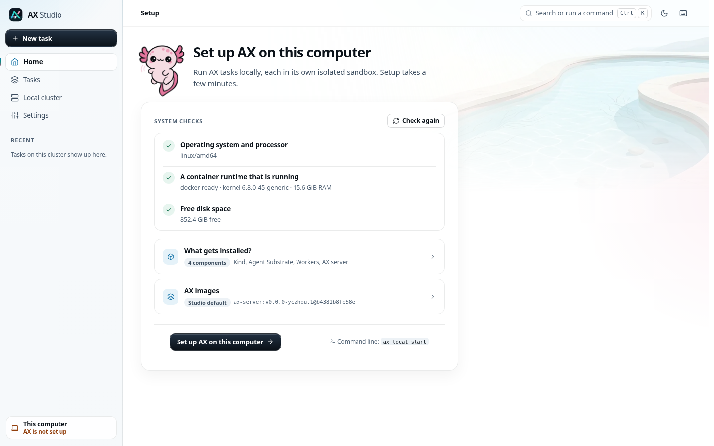
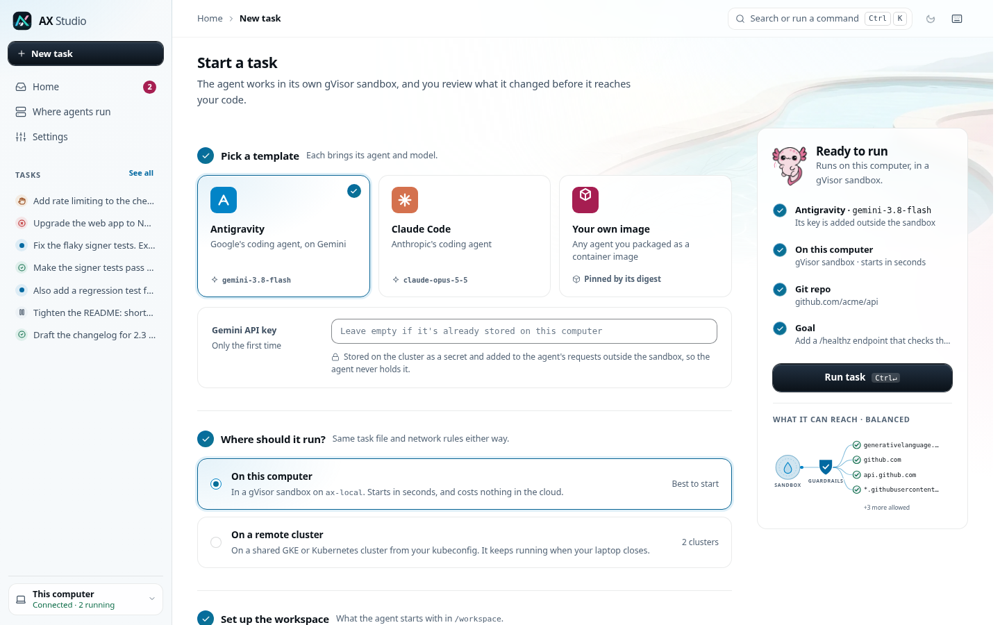
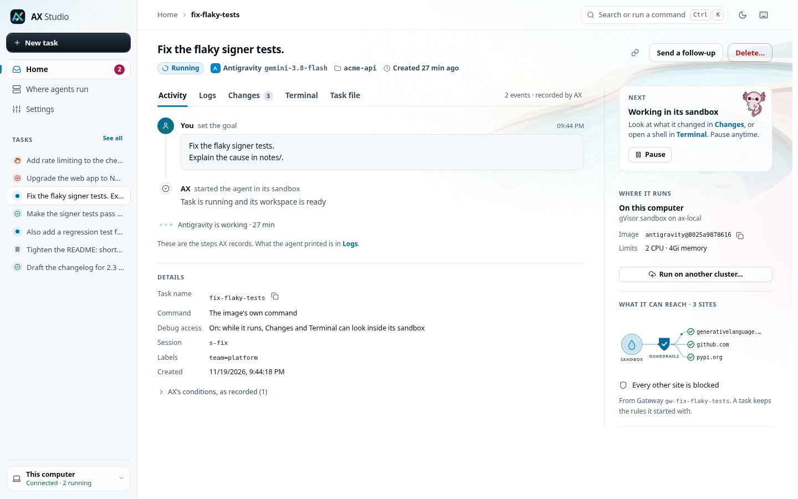
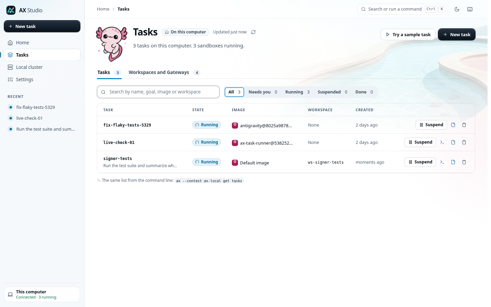
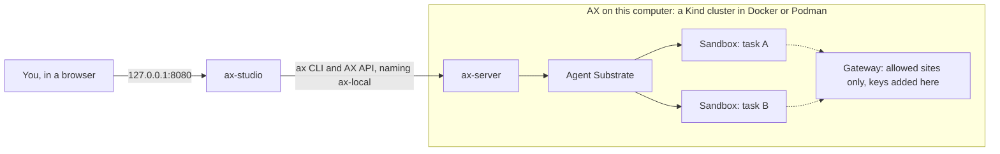

<div align="center">

# AX Studio

**Set up AX on your computer, start tasks in their own sandboxes,<br>and see what they do: their state, their logs, and a shell inside.**

[](https://github.com/agentexecutor/studio/actions/workflows/ci.yml) [](LICENSE)

[Quick start](#quick-start) · [Tour](#a-quick-tour) · [How it works](#how-it-works) · [For agents](#for-agents-and-scripts) · [Reference](#reference) · [Troubleshooting](#troubleshooting) · [Development](#development)

</div>

## What is AX Studio?

AX Studio is the local web app for [AX](https://github.com/google/ax), a task orchestrator. It's one small binary that opens in your browser and works with AX on your computer: a Kubernetes cluster in your container runtime that AX sets up for you.

- **Set up AX in one click.** Studio checks this computer, then runs `ax local start` and shows each step as it happens.
- **Start tasks.** From Antigravity, Claude Code, your own image, or a task file. Each task runs in its own sandbox and can only reach the sites you allow. An API key is added outside the sandbox, so the task never holds it.
- **See what they do.** Every task's state, what AX recorded, its logs, and a shell inside its sandbox. Suspend, resume or delete it.

## Quick start

You need `ax`, AX's command-line tool, at the version Studio is built against or later. Studio uses it to set up AX, start tasks and open shells.

**1. Install Studio and `ax`** (needs Go 1.27 or later):

```bash
go install github.com/agentexecutor/studio/cmd/ax-studio@latest
go install github.com/google/ax/cmd/ax@main
```

Both land in `$(go env GOPATH)/bin` (usually `~/go/bin`), which needs to be on your `PATH`. `ax` comes from `main` because the latest AX release, v0.3.1, is older than Studio needs: it doesn't have `ax local status -o json`.

**2. Start Studio:**

```bash
ax-studio   # opens http://127.0.0.1:8080
```

**3. Set up AX on this computer.** Studio opens on setup until AX runs here. Click **Set up AX on this computer**: Studio runs `ax local start`, which creates a Kind cluster with Agent Substrate and AX in Docker or Podman. AX doesn't publish release images yet, so Studio deploys images built from the same AX commit as its [`go.mod`](go.mod). To use others, set `AX_SERVER_IMAGE`, or enter them under **AX images**.

**4. Start a task.** Click **New task**, pick Antigravity, Claude Code or Blank, describe the goal, and press **Create task**.

> [!TIP]
> When an AX release includes AX Studio, AX's installer sets up both tools, and `ax studio` starts Studio:
> ```bash
> curl -fsSL https://github.com/google/ax/releases/latest/download/install.sh | sh
> ax studio
> ```

Stopping Studio (`Ctrl-C`) only stops the web app. AX on this computer and its tasks keep running.

## A quick tour

<p align="center">
  <picture>
    <source media="(prefers-color-scheme: dark)" srcset="docs/screenshots/home-dark.png">
    
  </picture>
</p>

<p align="center"><b>Home.</b> What's running on this computer, what needs you, and your most recent tasks.</p>

<table>
  <tr>
    <td width="50%" valign="top"><br><b>Setup.</b> Studio checks this computer, then runs <code>ax local start</code> and shows each step.</td>
    <td width="50%" valign="top"><br><b>New task.</b> Start from Antigravity, Claude Code or Blank. The YAML beside it is what Studio applies.</td>
  </tr>
  <tr>
    <td width="50%" valign="top"><br><b>A task.</b> What AX recorded, its state, where it runs, and the sites it can reach.</td>
    <td width="50%" valign="top"><br><b>Logs.</b> What the task and its sandbox print, as it happens.</td>
  </tr>
  <tr>
    <td width="50%" valign="top"><br><b>Terminal.</b> A real shell in the task's sandbox, through <code>ax ssh</code>. Open more shells as tabs.</td>
    <td width="50%" valign="top"><br><b>Tasks.</b> Search and filter every task, with Suspend or Resume on each row. Workspaces and Gateways have their own tab.</td>
  </tr>
</table>

## How it works



- **Local only.** Studio listens on `127.0.0.1` and nowhere else. Nothing is exposed to your network.
- **Your kubeconfig stays yours.** Studio works with AX on this computer only, and names its cluster on every request (`--context ax-local`), whatever your current context is. It never switches or edits your contexts.
- **Sandboxed tasks.** Each task runs in its own sandbox on Agent Substrate. Its outbound traffic goes through a Gateway that allows only the sites the task needs.
- **Keys stay outside.** An API key you give Studio is stored on the cluster as a Secret. The Gateway adds it to the task's requests, so it never enters the sandbox.
- **No lock-in.** Every action shows the `ax` command that does the same, ready to copy.

## For agents and scripts

Everything Studio does has an `ax` equivalent, so an agent should drive AX directly. Add `-a <atespace>` when you don't use the `default` atespace.

| In Studio | The same with `ax` |
|:---|:---|
| Your tasks | `ax --context ax-local get tasks` |
| A task's details | `ax --context ax-local get task <name>` |
| New task | `ax --context ax-local apply -f task.yaml`, then `ax --context ax-local resume task <name>` |
| Suspend, resume, delete | `ax --context ax-local suspend task <name>` (or `resume`, `delete`) |
| Terminal | `ax --context ax-local ssh <name>` |
| AX on this computer | `ax local start`, `ax local stop`, `ax local delete`, `ax local status -o json` |
| Workspaces, Gateways, models | `ax --context ax-local get workspaces` (or `gateways`, `models`) |

<details>
<summary><strong>Reading what Studio sees</strong> (its local API)</summary>

Studio's API serves its web page and can change between releases, so treat it as read-only diagnostics. It needs the session cookie from `/api/bootstrap`. `GET /healthz` doesn't.

```bash
curl -s -c /tmp/ax-studio.jar http://127.0.0.1:8080/api/bootstrap > /dev/null
curl -s -b /tmp/ax-studio.jar http://127.0.0.1:8080/api/env/status                  # this computer, AX on it, checks, tools
curl -s -b /tmp/ax-studio.jar "http://127.0.0.1:8080/api/tasks?context=ax-local"    # its tasks
```

Requests that change something also need the `X-AX-CSRF-Token` header from the bootstrap response. Use `ax` for those instead.

</details>

## Reference

### Command-line flags

| Flag | Default | What it does |
|:---|:---|:---|
| `--port` | `8080` | Port to listen on, on `127.0.0.1` |
| `--addr` | | Full loopback address, such as `127.0.0.1:9090` (overrides `--port`) |
| `--namespace` | `ax-system` | Namespace AX runs in. Short form: `-n` |
| `--ax-bin` | `~/.ax/bin/ax`, then `PATH` | The `ax` to run |
| `--no-open` | | Don't open a browser, for SSH sessions and scripts |
| `--ux-dir` | | Serve the web UI from this folder instead of the built-in copy, for working on `ux/` |
| `--version` | | Print the version and exit |

`ax studio` passes your `ax` and its namespace to Studio for you (`--ax-bin`, `-n`), along with any flags you add.

### Environment variables

| Variable | What it does |
|:---|:---|
| `AX_SERVER_IMAGE` | The AX server image setup deploys, instead of Studio's own. You can also enter one in Studio. |
| `AX_RUNNER_VOLUME_IMAGE` | The runner volume setup mounts into every task, instead of Studio's own. Agent images without a runner of their own, such as `agy-cli`, need one. |
| `AX_DEFAULT_TASK_IMAGE` | The image of a task that doesn't name one, instead of Studio's own |
| `KUBECONFIG` | The kubeconfig files Studio reads (default `~/.kube/config`). Studio never writes to them. |
| `AX_HOME` | Where AX keeps its files (default `~/.ax`). Studio looks for its tools in `$AX_HOME/bin`. |
| `AX_BIN_DIR` | Where to look for `ax`, `kubectl` and `kind`, instead of `~/.ax/bin` |
| `AX_BIN` | The `ax` to run, when `--ax-bin` isn't given |
| `AX_STUDIO_NO_OPEN` | Set to `1` for the same as `--no-open` |

### Requirements

| To | You need |
|:---|:---|
| Run Studio | Linux or macOS (amd64 or arm64), a modern browser, and `ax` at the version in [`go.mod`](go.mod) or later |
| Run tasks on this computer | Docker, or Podman in rootful mode, on Linux with kernel 6.8 or later; OrbStack, Docker Desktop or Colima on macOS. At least 8 GiB of free disk (15 GiB recommended) |
| Install with `go install` | Go 1.27 or later |
| Build from source | Go 1.27 or later. Node.js to run the UI smoke tests (`make test`) |

### Security

- **Loopback only.** Studio refuses to listen on `0.0.0.0` or any other interface. It rejects requests whose `Host` isn't loopback (a defense against DNS rebinding) and cross-origin requests.
- **Session and CSRF.** Each run has its own session cookie (`HttpOnly`, `SameSite=Strict`). Every request that changes something needs a matching `X-AX-CSRF-Token`. The page runs under a strict Content Security Policy (`script-src 'self'`).
- **Limited commands.** The page can run only a short list of `ax` subcommands: never another program, and never a file from your disk. Secret values go to `kubectl` over standard input, not the command line, and tokens are removed from diagnostics.

## Troubleshooting

<details>
<summary><strong>"AX on ax-local and AX Studio are different versions"</strong></summary>

Studio and the ax-server on this computer were built from different versions of AX's API and can't read each other's data (`invalid wire-format data`). Update the older one: **Update** on **Local cluster** redeploys ax-server with Studio's images. Both `ax` and ax-server should be at the version in [`go.mod`](go.mod) or later.
</details>

<details>
<summary><strong>Studio can't tell whether AX runs on this computer</strong></summary>

Your `ax` is older than Studio needs: it has no `ax local status -o json`. Install a newer one, as in [Quick start](#quick-start), then click **Check again**.
</details>

<details>
<summary><strong>Setting up AX on this computer times out</strong></summary>

This usually means a pod can't pull its image. The Output panel on **Local cluster** has what `ax local start` said, including the pod that's stuck and why. To look yourself:

```bash
kubectl --context ax-local get pods -A
kubectl --context ax-local describe pod <pod> -n <namespace>
```

If the pull times out, containers can't reach the registry. On Linux, check that `docker info` shows `IPv4Forwarding: true`, and check any proxy or firewall.
</details>

<details>
<summary><strong>Port 8080 is in use</strong></summary>

Start Studio on another port: `ax-studio --port 8081` (or `ax studio --port 8081`).
</details>

<details>
<summary><strong>Opening Studio from another computer</strong></summary>

Studio only accepts requests addressed to `127.0.0.1` or `localhost`, on purpose. Forward the port over SSH, then open http://localhost:8080 on the computer you're using:

```bash
ssh -N -L 8080:127.0.0.1:8080 <host-running-studio>
```
</details>

## Uninstall

1. **Stop Studio:** press `Ctrl-C` where it runs.
2. **Remove AX from this computer:** click **Remove** on **Local cluster**, or run `ax local delete`.
3. **Remove the binaries and caches:** everything `install.sh` and `ax` put on your computer is in `~/.ax`. That includes `ax`, `ax-studio`, tunnel state, short-lived `ax ssh` certificates, and any `kind` or `kubectl` that `ax` downloaded.
   ```bash
   rm -rf ~/.ax
   ```
   Studio never changes your system tools or your `~/.kube/config`. If you added `~/.ax/bin` to your `PATH`, remove that line from your shell profile.

## Development

| Path | What's there |
|:---|:---|
| [`cmd/ax-studio`](cmd/ax-studio) | The binary: flags, and opening the browser |
| [`internal/studio`](internal/studio) | The local server: API, session, operations and checks |
| [`internal/kube`](internal/kube) | Finding and running `ax`, `kubectl` and `kind` |
| [`ux`](ux) | The web UI: plain HTML, CSS and JavaScript with no build step. See [`ux/README.md`](ux/README.md) |
| [`docs/screenshots`](docs/screenshots) | The screenshots in this README |

```bash
git clone https://github.com/agentexecutor/studio && cd studio
make build                             # bin/ax-studio
make test                              # UI smoke tests (needs Node.js), Go tests with -race
make verify                            # make test, then gofmt and go vet (what CI runs)
./bin/ax-studio --ux-dir ux            # serve ux/ from disk, so a reload shows your edit
```

### Release

A release is the `ax-studio` binary for Linux and macOS (amd64 and arm64). Tag a commit on `main` or a `release-*` branch and push the tag. [The Release workflow](.github/workflows/release.yml) tests, builds and publishes `ax-studio_<os>_<arch>.tar.gz` for each platform, with `checksums.txt`, to a GitHub release for the tag:

```bash
git tag v0.1.0 <commit>
git push origin v0.1.0
```

- The workflow refuses a tag on any other commit, so a tag on an unreviewed branch can't publish.
- `ax-studio --version` prints the tag.
- A tag with a `-`, such as `v0.1.0-rc.1`, becomes a prerelease.
- To try a build without publishing, run the workflow by hand from the Actions tab. The archives stay as workflow artifacts.
- AX's [`install.sh`](https://github.com/google/ax/blob/main/install.sh) installs the Studio release it names, not the latest one. After a release, set `PINNED_STUDIO_VERSION` there to the new tag, and `pinned_studio_sha256` to the four digests in `checksums.txt`.

## License

[Apache 2.0](LICENSE)
