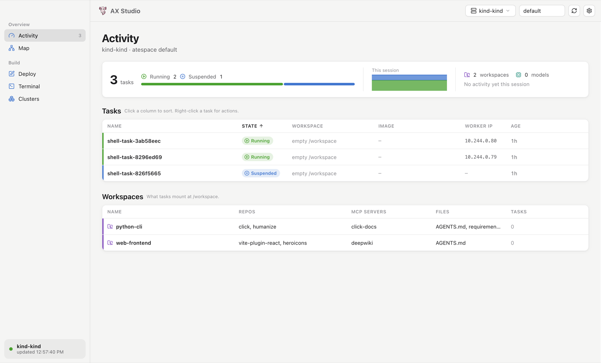
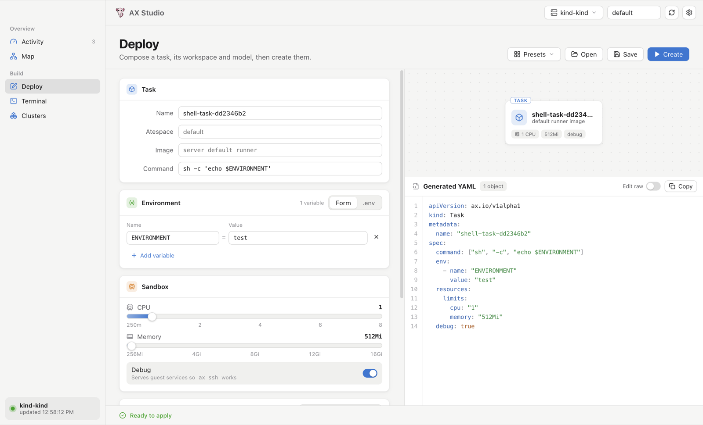
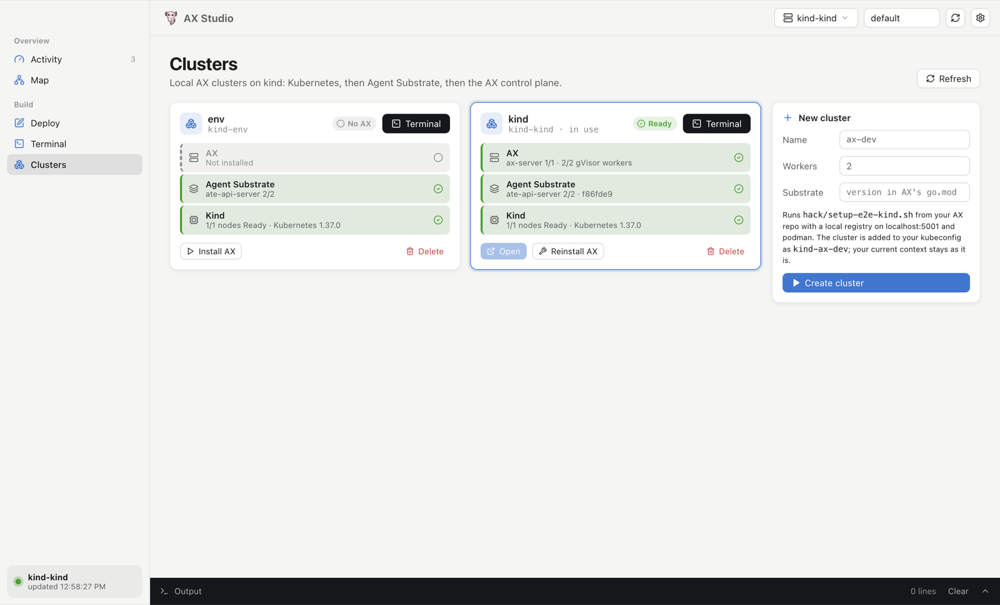
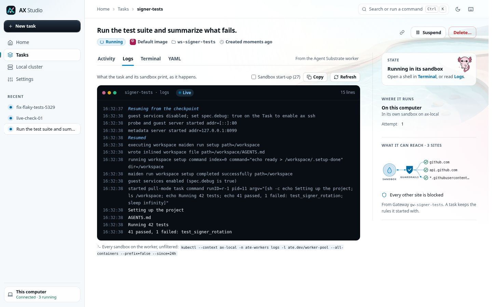

# AX Studio

A desktop app for [AX](https://github.com/google/ax): design tasks, watch them run, and create local
AX clusters. Runs on macOS, Windows and Linux.



- **Activity:** a sortable task table with running tasks on top, and the
  atespace's workspaces. Resume, suspend or delete tasks, inspect conditions,
  follow logs and delete workspaces.
- **Deploy:** build tasks with a form or raw YAML, then create them.
- **Terminal:** sessions into running tasks over `ax ssh`, in tabs that stay
  connected while you use the rest of the app.
- **Clusters:** create, inspect and delete local AX clusters on kind.

| | |
|---|---|
|  **Deploy** |  **Terminal** |
|  **Clusters** |  **Task logs** |

The app calls the `ax` CLI and `kubectl`. It passes `--context` on every call,
so browsing and managing tasks never changes your global context. Creating or
starting a local cluster does: `ax local start` makes that cluster current.

## Develop

```sh
npm install
npm run dev         # hot-reloading app
npm run typecheck
```

The app uses the `ax` on your PATH or in `~/.ax/bin`. To develop against
another `ax`, such as one you built from source, set its full path in Settings
(⌘,).

To refresh a screenshot, build (`npm run build`) and run:

```sh
npx electron . --section=clusters --cluster=ax-dev --delay=7000 --screenshot=docs/screenshots/clusters.png
```

Other flags: `--context`, `--atespace`, `--task`, `--logs=expanded`, `--terminal=<command>`.

## Package

```sh
npm run dist:mac    # .dmg and .zip
npm run dist:win    # NSIS installer and .zip
npm run dist:linux  # AppImage, .deb, .tar.gz
```

Build each OS on that OS. macOS builds are unsigned; set `mac.identity` in
`electron-builder.yml` to sign. To regenerate the icon on macOS:

```sh
swift scripts/make-icon.swift ~/ax/assets/axel.svg build-resources/icon.icns
```

## Clusters

The Clusters page drives `ax`, so it needs only a running `docker` or `podman`:

- **Create cluster** and **Start** run `ax local start`, which creates or
  resumes a kind cluster, installs Agent Substrate and AX, and downloads kind
  and kubectl into `~/.ax/bin` if you don't have them. The cluster becomes your
  current kubectl context: `ax-local` for the default name, `kind-<name>`
  otherwise.
- **Install AX** runs `ax install` on a cluster that already has Agent
  Substrate, whether it's a kind cluster or any other context in your
  kubeconfig. A kind cluster without Substrate gets `ax local start` instead.
- **Delete** runs `ax local delete`.

`ax` has no default ax-server image yet, so the form asks for one. The app
remembers the images you enter.

## Platform notes

- **macOS/Linux:** the app reads PATH from your login shell, and also looks in
  `~/.ax/bin` (or `$AX_HOME/bin`), where AX's installer puts `ax`.
- **Windows:** AX has no Windows build of `ax`, so the Clusters page can't
  create clusters there.
